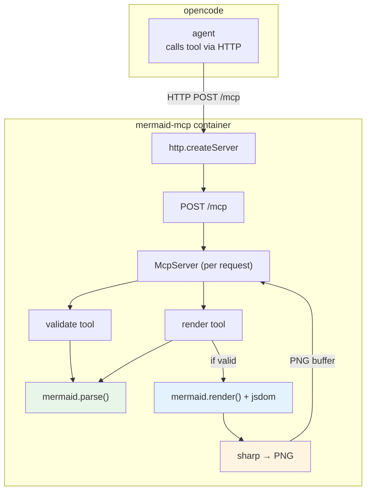
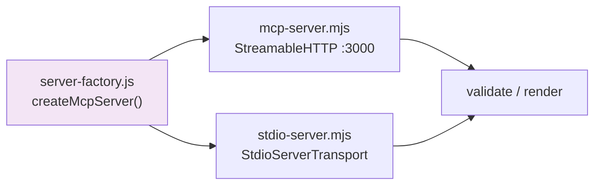

# mermaid-mcp

Custom Mermaid MCP server — fast validation + PNG/SVG rendering via **jsdom + sharp**, no Chromium needed.

Replaces the broken `@rtuin/mcp-mermaid-validator` that consistently timed out (MCP error -32001) for every invocation, even on trivially small diagrams. The root cause was shell + npx overhead spawning Chromium/Puppeteer. This server eliminates Chromium entirely — smaller image, faster renders, no browser crash risk.

## Why It Exists

The original `@rtuin/mcp-mermaid-validator@0.7.0` used `@mermaid-js/mermaid-cli` under the hood, which spawns a headless Chromium browser for every render. This caused:

- **Timeouts** — Chromium startup takes 2-5 seconds, exceeding MCP request timeouts
- **Large image** — ~1 GB Docker image (Chromium + Node.js)
- **Crash risk** — Headless browser crashes on certain diagram types

This server replaces Chromium with **jsdom** (fake DOM) + **sharp** (SVG → PNG rasterization), resulting in:

- **Instant validation** — ~50 ms (pure Node.js, `mermaid.parse()`)
- **Fast rendering** — ~30-100 ms (jsdom + sharp, no browser)
- **Tiny image** — ~150-300 MB (no Chromium)
- **Reliable** — No browser crash risk

## Features

| Feature | Description |
|---------|-------------|
| **`validate`** | Parse-only validation — instant, no rendering, no DOM needed |
| **`render`** | Full rendering to PNG (default) or SVG via jsdom + sharp, no browser |
| **Stateless** | Per-request `McpServer` + transport — no cross-request state |
| **HTTP-native** | Node.js built-in `http` module — no Express dependency |
| **Two transports** | Streamable HTTP (port 3000) **and** stdio (stdin/stdout) — same tools |
| **Docker-ready** | Multi-arch (amd64 + arm64), small image |
| **Structured logging** | JSON logs to stderr, debug level via `LOG_LEVEL` env var |

## Architecture



The tool layer is transport-agnostic — `src/server-factory.js` builds the `McpServer`
once, and each transport only supplies its own connection:



**Key design decisions:**

| Concern | Decision | Rationale |
|---------|----------|-----------|
| Transport | HTTP (StreamableHTTPServerTransport, port 3000) **or** stdio (stdin/stdout) | Remote opencode access over HTTP; stdio for local clients and for `mcp-proxy` |
| HTTP server | Node.js built-in `http` | No Express dependency, per user request |
| Tool layer | Shared `createMcpServer()` factory | Same tools and metadata on both transports, no duplication |
| Validation | `mermaid.parse()` | Pure Node.js, instant, no DOM |
| Rendering | jsdom + sharp (no Chromium) | Mermaid v11+ `render()` works with jsdom; sharp rasterizes SVG→PNG |
| Docker base | `node:26.3.0-slim` | Latest stable, no Chromium — tiny image, fast pulls |
| Output | PNG default, SVG optional | PNG for inline chat; SVG for editable diagrams |

## Quick Start

### Prerequisites

- Node.js 26+ (see `.nvmrc`)
- Docker Desktop with Docker Compose

### Local Development

```bash
# Clone and install
cd ~/www/misc/mermaid-mcp
npm install

# Run locally (port 3000)
npm start

# Run locally as a stdio MCP server
npm run start:stdio

# Run tests (70 pass, 1 skip, 0 fail)
npm test
```

### Docker Compose

```bash
# Build and start
./start.sh

# Stop
./stop.sh

# Smoke test (7 HTTP tests via curl)
./test/smoke.sh
```

### Build and Push to Docker Hub

```bash
# Build + push (latest)
./build-and-push.sh

# Tag with version
./build-and-push.sh --tag v1.0.0

# Build only (skip push)
./build-and-push.sh --build-only

# ARM64 only
./build-and-push.sh --platform linux/arm64

# Dry run (show commands, don't execute)
./build-and-push.sh --dry-run
```

## Transport Modes

The same two tools are exposed over two transports.

| Mode | Entry point | Endpoint | Use when |
|------|-------------|----------|----------|
| **HTTP** | `src/mcp-server.mjs` | `POST http://:3000/mcp` | The server runs in Docker / on another host and clients reach it over the network |
| **stdio** | `src/stdio-server.mjs` | stdin/stdout (JSON-RPC) | The client spawns the server as a child process, or a proxy does |

### stdio mode

```bash
npm run start:stdio
```

- stdout carries **JSON-RPC messages only** — every log line goes to stderr, so the stream stays parseable.
- The server exits with code `0` when stdin is closed (EOF) — the shutdown sequence `mcp-proxy` relies on.

### stdio mode behind `mcp-proxy`

[`sparfenyuk/mcp-proxy`](https://github.com/sparfenyuk/mcp-proxy) spawns a stdio MCP server as a child
process and re-exposes it as SSE / Streamable HTTP. That is the shortest path from a local stdio server
to a remote HTTP endpoint:

```bash
# Proxy on :8080, our server spawned as a child process
mcp-proxy --port=8080 --pass-environment -- node /abs/path/to/mermaid-mcp/src/stdio-server.mjs

# → http://127.0.0.1:8080/mcp   (Streamable HTTP)
# → http://127.0.0.1:8080/sse   (SSE)
```

Use an **absolute path** to the script — the proxy runs the child in its own working directory.
`--pass-environment` forwards `PATH` and the rest of the environment to the child.

Ready-made image (official proxy image + our stdio server in one container):

```bash
docker build -f Dockerfile.stdio-proxy -t mermaid-mcp-stdio-proxy .
docker run --rm -p 8080:8080 mermaid-mcp-stdio-proxy
```

Or use the bundled helper — it fetches the named-server config from GitHub, builds the image
and runs the proxy on **:8097**:

```bash
./proxy.sh start     # → http://127.0.0.1:8097/servers/mermaid/mcp
./proxy.sh status
./proxy.sh stop
```

The config (`config/servers.json`) lives in this repo and is read by the proxy via
`--named-server-config`; `docker-compose.proxy.yml` describes the same container declaratively.

See [docs/mcp-proxy.md](./docs/mcp-proxy.md) for the full recipe, including named servers and the
reverse direction (proxying the HTTP server as a stdio server).

## Tool Reference

### `validate`

Validate a Mermaid diagram definition without rendering. Returns the detected diagram type on success or a parse error with line number on failure. Pure Node.js — instant, no browser needed.

**Input:**

| Parameter | Type | Required | Description |
|-----------|------|----------|-------------|
| `diagram` | `string` | Yes | Mermaid diagram definition text |

**Output (valid):**

```json
{
  "content": [
    {
      "type": "text",
      "text": "Valid: flowchart"
    }
  ]
}
```

**Output (invalid):**

```json
{
  "content": [
    {
      "type": "text",
      "text": "Invalid: Parse error on line 3: ..."
    }
  ],
  "isError": true
}
```

**Example (MCP JSON-RPC):**

```bash
curl -X POST http://localhost:3000/mcp \
  -H "Content-Type: application/json" \
  -H "Accept: application/json, text/event-stream" \
  -d '{
    "jsonrpc": "2.0",
    "id": 1,
    "method": "tools/call",
    "params": {
      "name": "validate",
      "arguments": {
        "diagram": "graph TD\n    A[Start] --> B[End]"
      }
    }
  }'
```

### `render`

Render a Mermaid diagram to PNG or SVG. Validates first, then renders via jsdom (no browser needed). PNG output uses 2x DPI (density 144) for crisp images.

**Input:**

| Parameter | Type | Required | Default | Description |
|-----------|------|----------|---------|-------------|
| `diagram` | `string` | Yes | — | Mermaid diagram definition text |
| `format` | `enum` | No | `png` | Output format — `png` (raster) or `svg` (vector) |
| `backgroundColor` | `string` | No | `transparent` | Background color for PNG (CSS color value, e.g. `"white"` or `"transparent"`) |

**Output (PNG):**

```json
{
  "content": [
    {
      "type": "text",
      "text": "Rendered as PNG (12345 bytes)"
    },
    {
      "type": "image",
      "data": "<base64-encoded PNG>",
      "mimeType": "image/png"
    }
  ]
}
```

**Output (SVG):**

```json
{
  "content": [
    {
      "type": "text",
      "text": "Rendered as SVG (5678 bytes)"
    },
    {
      "type": "image",
      "data": "<base64-encoded SVG>",
      "mimeType": "image/svg+xml"
    }
  ]
}
```

**Output (error):**

```json
{
  "content": [
    {
      "type": "text",
      "text": "Error: Parse error on line 3: ..."
    }
  ],
  "isError": true
}
```

**Example (MCP JSON-RPC):**

```bash
curl -X POST http://localhost:3000/mcp \
  -H "Content-Type: application/json" \
  -H "Accept: application/json, text/event-stream" \
  -d '{
    "jsonrpc": "2.0",
    "id": 2,
    "method": "tools/call",
    "params": {
      "name": "render",
      "arguments": {
        "diagram": "graph TD\n    A[Start] --> B[End]",
        "format": "png",
        "backgroundColor": "white"
      }
    }
  }'
```

## Development

### Running Locally

```bash
# Start the server (port 3000)
npm start

# Start with debug logging
LOG_LEVEL=debug npm start

# Start on a different port
MCP_PORT=8080 npm start
```

### Running Tests

```bash
# All tests (70 pass, 1 skip, 0 fail)
npm test

# Specific test file
node --test test/renderer.test.js
node --test test/tools.test.js
node --test test/mcp-server.test.js
node --test test/stdio-server.test.js
```

### Test Coverage

| Test File | Tests | Coverage |
|-----------|-------|----------|
| `test/renderer.test.js` | 36 | Validate (6 diagram types), render SVG (6 types), render PNG (5 types + 1 skipped), error paths |
| `test/tools.test.js` | 4 | Tool schema registration, validate handler, render handler (PNG + SVG) |
| `test/mcp-server.test.js` | 21 | MCP protocol (initialize, tools/list, tools/call), HTTP error codes (405, 415, 413, 400) |
| `test/stdio-server.test.js` | 10 | stdio protocol (initialize, tools/list, tools/call), stdout purity, logs on stderr, clean exit on stdin EOF |
| **Total** | **71** | **70 pass, 1 skip, 0 fail** |

### Smoke Tests (Docker)

```bash
# Start compose, wait for server, run 7 HTTP tests
./start.sh && ./test/smoke.sh
```

The smoke test suite (`test/smoke.sh`) tests via `curl` against the running container:
1. MCP initialize handshake
2. `tools/list` returns 2 tools (validate, render)
3. `validate` — valid flowchart
4. `validate` — invalid diagram
5. `render` — PNG format
6. `render` — SVG format
7. `render` — invalid diagram

### Build and Push

```bash
# Build + push to tuiteraz/mermaid-mcp:latest (multi-arch: amd64 + arm64)
./build-and-push.sh

# Build only (local image)
./build-and-push.sh --build-only

# Push with version tag
./build-and-push.sh --tag v1.0.0

# ARM64 only
./build-and-push.sh --platform linux/arm64

# Dry run (preview commands)
./build-and-push.sh --dry-run
```

## Deployment

### Local Compose

```bash
# Start (builds image, runs container)
./start.sh

# Stop
./stop.sh
```

### opencode Integration

To use this server with [opencode](https://github.com/anomalyco/opencode), add the following to your MCP configuration:

```jsonc
"mermaid": {
  "type": "remote",
  "url": "http://localhost:3000/mcp",
  "enabled": true,
  "category": "validation",
  "enabledTools": ["validate", "render"]
}
```

For remote deployments, replace the URL with your server's address.

To run it as a **local** stdio server instead (the client spawns the process):

```jsonc
"mermaid": {
  "type": "local",
  "command": ["node", "/abs/path/to/mermaid-mcp/src/stdio-server.mjs"],
  "enabled": true,
  "category": "validation",
  "enabledTools": ["validate", "render"]
}
```

Or reach it through the bundled **mcp-proxy** (`./proxy.sh start`):

```jsonc
"mermaid": {
  "type": "remote",
  "url": "http://localhost:8097/servers/mermaid/mcp",
  "enabled": true,
  "category": "validation",
  "enabledTools": ["validate", "render"]
}
```

## Project Structure

```
mermaid-mcp/
├── Dockerfile                     # node:26.3.0-slim + fonts-dejavu + fonts-liberation
├── Dockerfile.stdio-proxy         # Official mcp-proxy image + our stdio server (one container)
├── docker-compose.yml             # Local compose (port 3000)
├── docker-compose.proxy.yml       # Compose for the mcp-proxy front (port 8097)
├── config/
│   └── servers.json               # mcp-proxy named-server config (canonical, committed)
├── cache/                         # Runtime cache of the proxy (gitignored)
├── package.json                   # Pinned deps, ESM, npm scripts
├── package-lock.json              # Lockfile
├── .nvmrc                         # Node.js 26
├── .gitignore
├── .husky/                        # Git hooks
├── start.sh                       # Start local compose (creates Docker network if needed)
├── stop.sh                        # Stop local compose
├── proxy.sh                       # Start/stop the mcp-proxy front (fetch config, build, run)
├── build-and-push.sh              # Build + push to Docker Hub (multi-arch)
├── test/
│   ├── mcp-server.test.js         # Server tests (21: MCP protocol + HTTP error codes)
│   ├── stdio-server.test.js       # stdio tests (10: protocol, tool calls, stdout purity, EOF exit)
│   ├── tools.test.js              # Tool tests (4: schema + handler)
│   ├── renderer.test.js           # Renderer tests (36: validate + render, 1 skip)
│   └── smoke.sh                   # Smoke tests (7 HTTP tests via curl)
└── src/
    ├── mcp-server.mjs             # Entry: http.createServer + StreamableHTTPServerTransport
    ├── stdio-server.mjs           # Entry: StdioServerTransport (stdin/stdout)
    ├── server-factory.js          # Shared createMcpServer() — both transports
    ├── tools.js                   # validate + render tool definitions (Zod schemas)
    ├── renderer.js                # Render pipeline: mermaid.parse → mermaid.render → sharp
    ├── polyfills.js               # jsdom + browser polyfills (rAF, ResizeObserver, CSSStyleSheet, SVG)
    ├── config.js                  # Frozen config object from env vars
    ├── logger.js                  # Structured JSON logging to stderr
```

### Key Files

| File | Purpose |
|------|---------|
| `src/mcp-server.mjs` | HTTP server entry point. Uses Node.js built-in `http.createServer` (no Express). Each request gets its own stateless `McpServer` + `StreamableHTTPServerTransport` pair. Handles POST `/mcp`, validates Content-Type, enforces body size limit (10 MB), graceful shutdown on SIGINT. |
| `src/stdio-server.mjs` | stdio entry point. Uses `StdioServerTransport` — one long-lived `McpServer` per process, JSON-RPC over stdin/stdout. stdout carries protocol traffic only; logs go to stderr. Exits with code `0` on stdin EOF, SIGINT or SIGTERM. |
| `src/server-factory.js` | Shared `createMcpServer()` — builds the `McpServer` (name, version, instructions) and registers the tools. Used by both transports so they expose the same surface. |
| `src/tools.js` | MCP tool definitions. `validate` — parse-only validation via `mermaid.parse()`. `render` — validate + render pipeline. Input schemas use Zod. Returns MCP-formatted responses with text + image content. |
| `src/renderer.js` | Core rendering pipeline. `validate(diagram)` — uses `mermaid.parse()` with `suppressErrors: false`, returns diagram type or parse error. `render(diagram, format, backgroundColor)` — validates first, then `mermaid.render()` for SVG, then `sharp` for PNG conversion (density 144, compression 9). |
| `src/polyfills.js` | Browser environment for Mermaid in Node.js. Creates a single `JSDOM` instance, attaches `window`/`document`/`Element` to `global`, polyfills `requestAnimationFrame`, `ResizeObserver`, `CSSStyleSheet`, SVG `getBBox`/`getCTM`. Lazy-loads DOMPurify + Mermaid via dynamic `import()` after globals are set. |
| `src/config.js` | Configuration — single frozen object loaded from environment variables at startup. No `process.env` access outside this module. |
| `src/logger.js` | Structured JSON logging to stderr (stdout is reserved for the protocol). `logInfo` always emits; `logDebug` only when `LOG_LEVEL=debug`. |

## Configuration

All configuration is loaded from environment variables at startup via `src/config.js`. No `process.env` access outside this module.

| Variable | Default | Description |
|----------|---------|-------------|
| `MCP_PORT` | `3000` | HTTP server port (HTTP transport only) |
| `MERMAID_DEFAULT_FORMAT` | `png` | Default output format (`png` or `svg`) |
| `MERMAID_BACKGROUND_COLOR` | `transparent` | Default background color for PNG rendering (CSS color value) |
| `MERMAID_SCALE` | `1` | Render scale factor |
| `LOG_LEVEL` | `info` | Log level (`info` or `debug`) |
| `MCP_MAX_BODY_SIZE` | `10485760` | Maximum request body size in bytes (10 MB, HTTP transport only) |

**Example:**

```bash
# Development with debug logging
LOG_LEVEL=debug MCP_PORT=8080 npm start

# Production with white background
MERMAID_BACKGROUND_COLOR=white MCP_PORT=3000 npm start
```

## Docker

### Image

```
FROM node:26.3.0-slim
├── fonts-dejavu          (~20 MB, proper Mermaid text rendering)
├── fonts-liberation      (~20 MB, Arial compatibility)
├── npm ci --omit=dev     (production deps only)
└── node src/mcp-server.mjs
```

**Image size:** ~150-300 MB (vs ~1 GB for mermaid-cli with Chromium)

### Registry

Images are pushed to `docker.io/tuiteraz/mermaid-mcp` via `build-and-push.sh`. Supports multi-arch builds (amd64 + arm64) via `docker buildx`.

## Known Issues

### Gantt PNG Rendering Fails

**Symptom:** Rendering a Gantt diagram to PNG fails with an image conversion error.

**Root cause:** Mermaid produces `viewBox="0 0 0 124"` (zero width) for Gantt diagrams when rendered via jsdom. This is a **mermaid rendering bug**, not an issue with this server. The SVG rendering path works fine for Gantt diagrams.

**Workaround:** Use `format: "svg"` for Gantt diagrams.

**Test:** The test `render PNG — gantt diagram` is skipped (`test.skip`) with this note. All other diagram types render to PNG successfully.

**Affected diagram type:** `gantt` only. Flowchart, sequence, class, state, ER, and pie diagrams all render to PNG correctly.

## License

MIT
