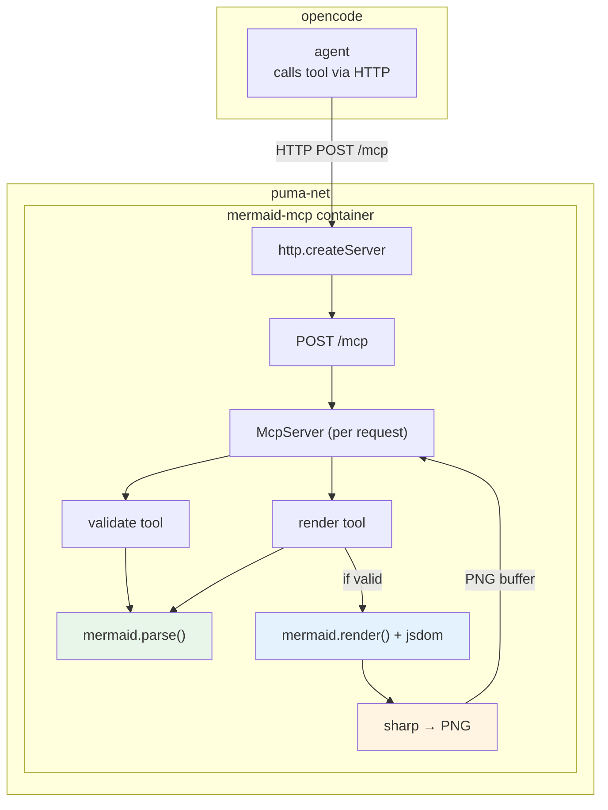

# mermaid-mcp

## Purpose

A custom MCP server that provides fast Mermaid diagram validation and PNG/SVG rendering, deployed as a Docker service on puma-net. Built as a replacement for the broken `@rtuin/mcp-mermaid-validator@0.7.0` that consistently timed out (MCP error -32001) for every invocation.

### Why the original validator broke

The original `@rtuin/mcp-mermaid-validator` used `@mermaid-js/mermaid-cli` under the hood, which spawns a headless Chromium browser for every render:

- **Timeouts** — Chromium startup takes 2-5 seconds, exceeding MCP request timeouts (the stdio transport had per-request timeout limits)
- **Large image** — ~1 GB Docker image (Chromium + Node.js)
- **Crash risk** — Headless browser crashes on certain diagram types

### This server's approach

This server replaces Chromium with **jsdom** (fake DOM) + **sharp** (SVG → PNG rasterization):

- **Instant validation** — ~50 ms (pure Node.js, `mermaid.parse()`)
- **Fast rendering** — ~30-100ms for SVG (jsdom, no browser)
- **Tiny image** — ~150-300 MB (no Chromium)
- **Reliable** — No browser crash risk

However, this approach has a fundamental tradeoff: sharp cannot render `<foreignObject>` elements that Mermaid v11+ uses for text labels. See [Current Approach & Problems](./spec/01-current-approach.md) for details and [Recommended Path: Playwright](./spec/02-recommended-playwright-approach.md) for the future direction.

---

## Features

See **[FEATURES.md](./FEATURES.md)** for detailed descriptions of each feature.

---

## Architecture



```text
┌─ opencode ────────────────────────────────┐
│ agent — calls the tool over HTTP          │
└─────────────────────┬─────────────────────┘
                      │ HTTP POST /mcp
                      ▼
┌─ puma-net ───────────────────────────────────────────────────────────────┐
│ ┌─ mermaid-mcp container ─────────────────────────────────────────────┐ │
│ │                                                                     │ │
│ │  http.createServer ──→ POST /mcp ──→ McpServer (per request)        │ │
│ │                                            │                        │ │
│ │                         ┌──────────────────┴─────────────┐          │ │
│ │                         ▼                                ▼          │ │
│ │                 validate tool                         render tool   │ │
│ │                         │                                │          │ │
│ │                         ▼                                ▼          │ │
│ │                 mermaid.parse()                 mermaid.parse()     │ │
│ │                                                          │          │ │
│ │                                                  (if valid)         │ │
│ │                                                          ▼          │ │
│ │                                       mermaid.render() + jsdom      │ │
│ │                                                          │          │ │
│ │                                                          ▼          │ │
│ │                                                  sharp → PNG        │ │
│ │                                                          │          │ │
│ │                                                    PNG buffer       │ │
│ │                                                          │          │ │
│ │                                                  └──→ McpServer     │ │
│ └─────────────────────────────────────────────────────────────────────┘ │
└─────────────────────────────────────────────────────────────────────────┘
```

- **Transport:** HTTP (StreamableHTTPServerTransport) — follows hugging-kreuzberg-mcp pattern
- **HTTP server:** Node.js built-in `http` module — no Express dependency
- **Stateless:** Per-request `McpServer` + transport pair — no cross-request state
- **Deployment:** Docker on puma-net, accessible via LiteLLM proxy at `https://lite-llm.lan/mcp/mermaid`
- **Second transport:** stdio (`src/stdio-server.mjs`) — same tools over stdin/stdout, for local clients and for `mcp-proxy` (see [mcp-proxy.md](./mcp-proxy.md))

---

## Quick Start

### Prerequisites

- Node.js 26 (`node:26.3.0-slim` in Docker)
- Docker Desktop or Docker Engine
- `fonts-dejavu` and `fonts-liberation` (installed in Docker image)

### Local Development

```bash
# Install dependencies
npm install

# Run tests
npm test

# Run locally (port 3000)
node src/mcp-server.mjs

# Run locally as a stdio MCP server
node src/stdio-server.mjs
```

### Docker

```bash
# Start local compose
./start.sh

# Run smoke tests
./test/smoke.sh

# Stop
./stop.sh
```

---

## Project Structure

```
mermaid-mcp/
├── src/
│   ├── mcp-server.mjs      # HTTP server + MCP transport
│   ├── stdio-server.mjs    # stdio server + MCP transport
│   ├── server-factory.js   # Shared createMcpServer() for both transports
│   ├── tools.js             # validate + render tool definitions
│   ├── renderer.js          # Validation + rendering pipeline
│   ├── polyfills.js         # jsdom browser polyfills
│   ├── config.js            # Configuration from env vars
│   └── logger.js            # Structured JSON logging
├── test/
│   ├── *.test.js            # Unit tests (Node.js test runner)
│   └── smoke.sh             # HTTP smoke tests via curl
├── docs/                    # Feature docs and specs
├── Dockerfile               # node:26.3.0-slim + fonts
├── docker-compose.yml       # Local smoke-test compose
├── start.sh / stop.sh       # Local compose lifecycle
├── build-and-push.sh        # Multi-arch Docker Hub push
├── README.md                # Project readme
└── mcp-proxy/               # Everything around the mcp-proxy front
    ├── Dockerfile           # Official mcp-proxy image + our stdio server
    ├── docker-compose.yml   # Compose for the mcp-proxy front
    ├── proxy.sh             # mcp-proxy front lifecycle (fetch config, build, run)
    ├── docker-entrypoint.sh # Runs /docker-entrypoint-init.d hooks, then execs the proxy
    ├── init.d/              # Auto-install hooks (e.g. 10-mermaid-preinstall.sh)
    ├── config/servers.json  # mcp-proxy named-server config
    └── README.md            # Full mcp-proxy recipe
```

---

## Known Issues

| Issue | Severity | Workaround |
|-------|----------|------------|
| **PNG: foreignObject text invisible** | 🔴 Critical | SVG works; PNG text is missing. See [spec/01](./spec/01-current-approach.md) |
| **SVG: viewBox too small** | 🔴 Critical | Layout calculated with polyfilled getBBox — most content outside viewBox |
| **SVG: edge labels NaN** | 🔴 Critical | `translate(undefined, NaN)` — getBBox approximation cascades |
| **Gantt: zero-width viewBox** | 🟡 Medium | Test skipped; SVG-only workaround |
| **Gantt: PNG broken** | 🟡 Medium | Test skipped; sharp rejects 0×0 images |

---

## Configuration

| ENV | Default | Description |
|-----|---------|-------------|
| `MCP_PORT` | `3000` | HTTP server port (HTTP transport only) |
| `MERMAID_DEFAULT_FORMAT` | `png` | Default render output format |
| `MERMAID_BACKGROUND_COLOR` | `transparent` | Default PNG background |
| `LOG_LEVEL` | `info` | Logging level (`debug` / `info`) |
| `MCP_MAX_BODY_SIZE` | `10485760` | Max request body size in bytes (HTTP transport only) |

---

## Deployment

### puma-net

```bash
# From puma-lan/lite-llm/mcp/mermaid/
./build-and-push.sh          # Build + push to Docker Hub
./start.sh                   # Deploy via Infisical + docker compose
```

### opencode Integration

```jsonc
// ~/.config/opencode/opencode.jsonc
"mermaid": {
  "type": "remote",
  "url": "https://lite-llm.lan/mcp/mermaid",
  "headers": {
    "Authorization": "Bearer sk-****"
  },      
  "enabled": true,
  "category": "validation",
  "enabledTools": ["validate", "render"]
}
```

For a local stdio deployment use the `local` type instead:

```jsonc
"mermaid": {
  "type": "local",
  "command": ["node", "/abs/path/to/mermaid-mcp/src/stdio-server.mjs"],
  "enabled": true,
  "category": "validation",
  "enabledTools": ["validate", "render"]
}
```
